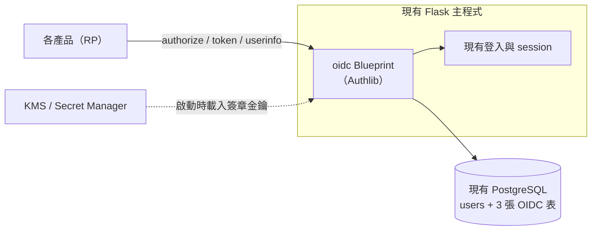
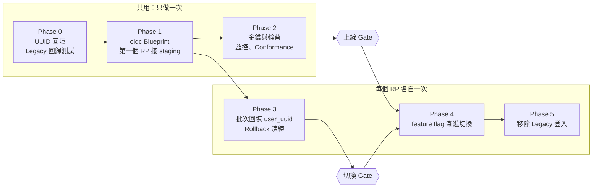
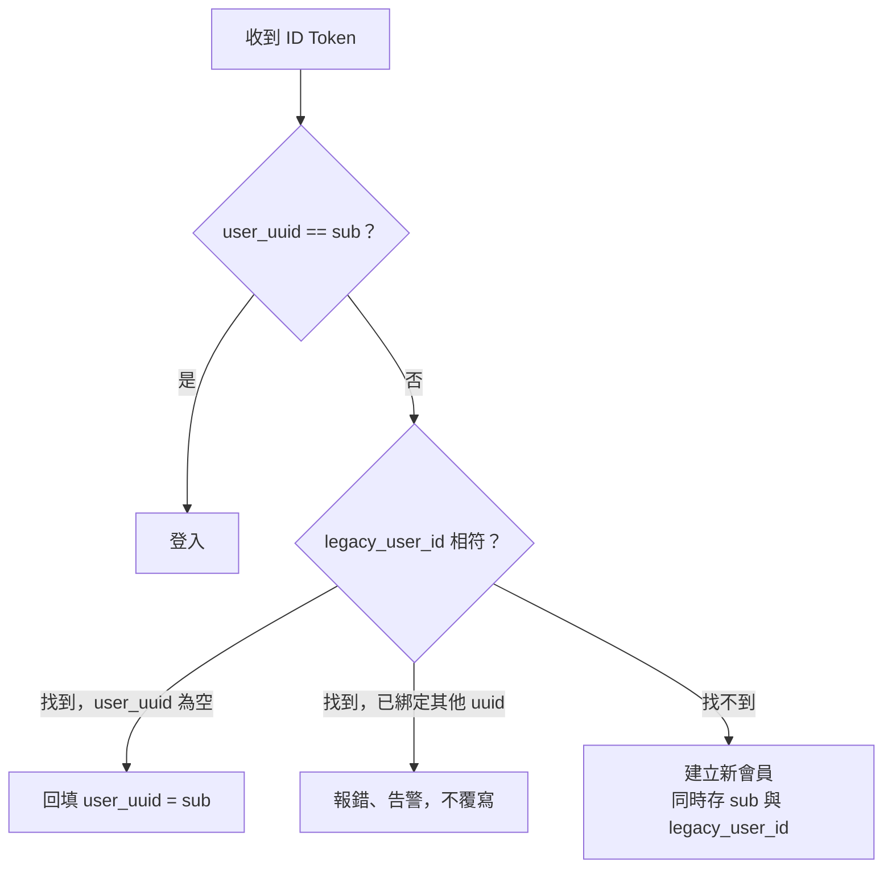

# OIDC Auth Server 決策紀錄

2026-10-26 · 狀態：提案

## 結論

在現有的 Flask 主程式裡加一個 OIDC Blueprint，用 Authlib 處理協定，資料存在現有的 PostgreSQL。不新增服務、不新增資料庫、不引入 Redis。

| 構想文件的選項 | 結論 |
| --- | --- |
| Gemini 1. Ory Hydra | 不採用：多一個 Go 服務要維運，和現有技術棧不同 |
| Gemini 2. 嵌入函式庫 | **採用：Authlib + Flask + PostgreSQL** |
| Gemini 3. 自建 Provider | 不採用：協定細節（PKCE、code 兌換、nonce、redirect URI 比對）交給 Authlib |
| Gemini 4. Keycloak | 不採用：太重 |
| GPT A–C | 合併成一條路線：Phase 0–5，上線 Gate 放在正式切換前 |
| GPT D 跨產品登出 | 延後；只有 `sid` 與基本登出第一天做 |

## 架構

放在主程式裡，是因為登入 session 與會員資料都在那裡，可以直接使用，不需要跨服務呼叫。Blueprint 自成一個模組（`oidc/`），只透過「查目前登入的使用者」和「查會員」兩個介面依賴主程式；日後真的需要拆成獨立服務時，搬走這個模組即可。

### 端點

| 端點 | 實作 |
| --- | --- |
| `GET /.well-known/openid-configuration` | 靜態 JSON |
| `GET /.well-known/jwks.json` | 由啟動時載入的私鑰導出公鑰 |
| `GET /oauth/authorize` | Authlib `AuthorizationServer`；未登入就導向現有登入頁 |
| `POST /oauth/token` | Authlib，authorization code grant + PKCE |
| `GET /oauth/userinfo` | Authlib `ResourceProtector`，回傳 `sub` 與（過渡期）`legacy_user_id` |
| `GET /oauth/logout` | RP-Initiated Logout；若所用 Authlib 版本沒有內建，就自寫一個小端點：驗 `id_token_hint`、比對已登記的 `post_logout_redirect_uri`、清除 session |

### PostgreSQL 資料表

| 表 | 內容 |
| --- | --- |
| `oauth2_client` | client_id、secret 雜湊、redirect URI 清單、允許的 scope；由管理者用 migration 或指令新增 |
| `oauth2_authorization_code` | code、client、user、PKCE challenge、nonce、到期時間（600 秒） |
| `oauth2_token` | access token（opaque）、client、user、scope、到期時間 |

主程式若已用 SQLAlchemy，可直接套用 Authlib 提供的 mixin。

**code 只能兌換一次：** 在 `query_authorization_code` 用 `DELETE ... RETURNING` 一次取出並刪除，不要先查再刪。兩個並發請求只會有一個拿到 code，不需要 Redis 或 Lua。後續驗證（PKCE、redirect URI）失敗時 code 也已作廢，這符合規範要求。

過期的 code 與 token 用排程定期清除即可。

### 簽章金鑰

金鑰存在 Secret Manager（或用 KMS 加密後存放），主程式啟動時載入記憶體，交給 Authlib 簽 ID Token。這是 Authlib 原生支援的做法，不必改寫它的簽章流程。

- 演算法：RS256。
- 輪替：JWKS 同時發布新舊兩把公鑰，切換簽章金鑰後，等舊 token 全部過期再移除舊公鑰。
- RP 遇到未知 `kid` 就重新取得 JWKS；驗證失敗一律拒絕。

每次簽章都呼叫 KMS 也做得到，但要覆寫 Authlib 的簽章流程，KMS 也會變成登入的必經依賴。等稽核真有要求「私鑰不得落地」時再做。

## 預設決定

以下是建議的預設值，各自可推翻，但 Phase 1 開始前要定案。

| 項目 | 預設 | 理由 |
| --- | --- | --- |
| Access token 格式 | opaque，存 PostgreSQL | 最簡單；可以直接刪除來撤銷 |
| Refresh token | v1 不做 | RP 用自己的 session；過期就重新走一次 authorize（使用者已登入時不需要再輸入密碼） |
| `redirect_uri` 比對 | 完全一致，不允許萬用字元 | 防止 code 被導到攻擊者網址 |
| Public client（SPA、App） | 只用 PKCE，不發 client secret | secret 放在前端等於公開 |
| `nonce` | 有帶就原樣寫入 ID Token，RP 必須驗證 | 防重放 |
| `prompt=login`、`max_age` | 支援；要求重新登入時走現有登入頁 | 參數由 Authlib 解析，是否要重新登入由 Blueprint 依 session 登入時間判斷 |
| Consent 畫面 | 不顯示 | 所有 RP 都是自家產品 |

## 上線路線

- 第一個 RP 在 Phase 1 就接 staging（即 GPT 文件的方案 A），越早用真實 RP 驗證越好。
- 上線 Gate 只需通過一次，放在第一次正式切換前；各 RP 的 Phase 3 可以和 Phase 2 平行進行。
- 一個 RP 出問題只回復該 RP：關掉它的 feature flag 即可回到 Legacy SSO。

| Phase | 退出條件 |
| --- | --- |
| 0 | 每個會員都有唯一 UUID；Legacy 回歸測試通過 |
| 1 | 第一個 RP 在 staging 端到端登入成功；協定與負向測試通過 |
| 2 | 金鑰輪替演練通過；OpenID Conformance Suite 通過；告警與 runbook 就緒；「正式環境基本要求」到位 |
| 3 | 該 RP 批次回填完成、衝突清單清空；rollback 後仍是同一會員 |
| 4 | flag 依序開到內部帳號 → 小比例 → 全部，每一階登入成功率正常（門檻待定） |
| 5 | 該 RP 已無 Legacy 登入流量；移除 `legacy` scope |

## RP 會員對應

**主方案：切換前批次回填。** Phase 0 完成後，主程式已有 `legacy_user_id → uuid` 對照表。每個 RP 切換前，匯出對照表、批次寫入 RP 會員表的 `user_uuid`，對不上的列成衝突清單、人工處理到清空。切換後，RP 登入只需要用 `sub` 查 `user_uuid`。

**安全網：登入時對應。** 只處理批次回填之後才出現的會員。

- 建立新會員時一定要存 `legacy_user_id`，否則 rollback 到 Legacy SSO 後，這些會員會消失。
- `user_uuid` 與 `legacy_user_id` 都加唯一性約束，避免並發的首次登入建出重複會員。
- 遷移期間（Phase 3 開始到所有 RP 完成 Phase 5）凍結帳號合併；這是「已綁定其他 uuid」最可能的來源。

### `legacy_user_id` 的退場

- 只在 `legacy` scope 下發出，只給正在遷移的 RP。
- 新 RP 一開始就只用 `sub`。
- RP 完成 Phase 5 就移除它的 `legacy` scope；全部完成後停用這個 claim。

## 範圍

| 功能 | 時程 |
| --- | --- |
| ID Token 帶 `sid` | 第一天（成本低，日後做 Back-Channel Logout 不必改格式） |
| RP-Initiated Logout | 第一天 |
| Back-Channel Logout、Session 同步、帳號切換、帳號異動通知 | 延後，另立專案 |

## 正式環境基本要求

OIDC 端點跑在主程式裡，可用性就跟著主程式；主程式掛掉，所有產品都無法登入。此外：

- 登入頁：CSRF 防護、`frame-ancestors` 防 clickjacking、登入後換新 session id。
- `/oauth/token` 與登入端點加速率限制。
- Client secret 只存雜湊；明文由 Secret Manager 交給 RP。
- 有效期限：code 600 秒、access token 與 ID Token 1 小時（建議值）。
- 稽核紀錄：登入、token 簽發、對應衝突、client 異動。

## 下一步

- [ ] 確認 Authlib 版本與 RP-Initiated Logout 支援情形。
- [ ] 確認「預設決定」表。
- [ ] 和既有 PR 作者對齊：從自建改為 Authlib Blueprint。
- [ ] 確認遷移期間凍結帳號合併的流程與負責人。
- [ ] 選定第一個 RP。
- [ ] 整理原始構想文件：修正 `idea_gemini.txt` 比較表的 ` ` 斷行；刪除 `idea_gpt.txt` 最後一行誤貼的 ChatGPT 建議追問。
