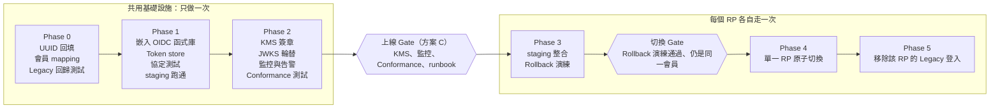
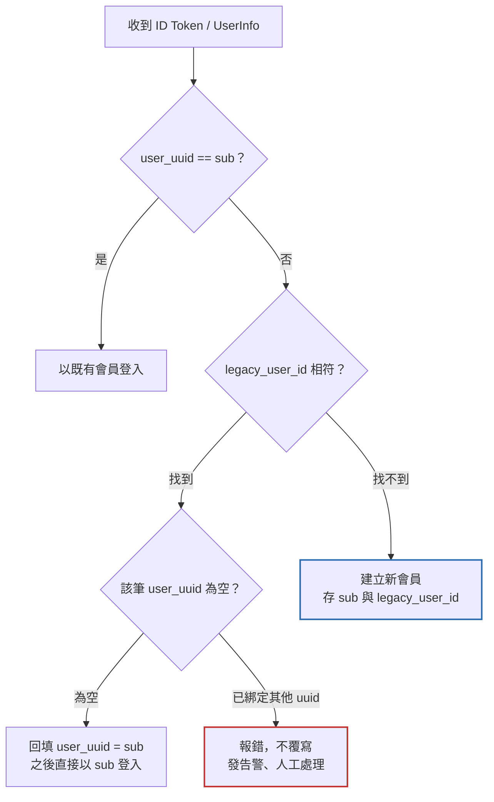

# OIDC Auth Server 決策紀錄

2026-10-26 · 線上版：<https://claude.ai/artifact/FuudiYXe8yDtpnEXvmZssR>

## 背景

兩份構想文件回答的是不同問題，需要各選一個答案，而不是二選一。

| 文件 | 回答的問題 | 選項 |
| --- | --- | --- |
| `doc/idea_gemini.txt` | Provider 要用什麼做 | 1. Ory Hydra · 2. 嵌入函式庫 · 3. 自建 · 4. Keycloak |
| `doc/idea_gpt.txt` | 要怎麼上線 | A. MVP · B. Phase 0–5 分階段 · C. 生產級安全 · D. 跨產品登出 |

本文件把兩者合併成一個決策：實作方式選一個，上線流程選一條，並補上兩份文件遺漏的規則。

## 決策：嵌入成熟 OIDC 函式庫（方案 2）

實作採 Gemini 文件的方案 2：在現有後端嵌入 Authlib（Python）或 oidc-provider（Node.js）；上線流程照 GPT 文件的 Phase 0–5。

- **和既定 PR 的矛盾：** Gemini 文件說 PR 規劃的是方案 3（自建），但 GPT 文件寫「使用標準 OIDC library」。這點要先定案，因為它決定每個 Phase 的工作量。
- **為什麼不自建：** 自建看似只有 5 個端點，但 PKCE、code 兌換、redirect URI 比對、nonce、錯誤回應都要自己寫、自己測。主要風險就在這些細節裡，函式庫已經做好了。
- **為什麼不用 Hydra：** 官方認證只涵蓋協定層；login/consent 串接、client 註冊、redirect URI 設定仍是自己的責任，所以「零 Conformance 風險」說法太滿；另外還要多維運一個 Go 服務。
- **為什麼不用 Keycloak：** 太重，適合外部第三方生態系，不是目前的內部 RP 場景。
- **部署位置待確認：** 從 `UserData` 與 Cloud KMS 來看，現有後端應是 GCP / Python，這樣 Authlib 最自然，而且不會放在 CDK stack 裡。

自建只保留給函式庫做不到的部分：signer interface、會員查詢、自訂 claims。

## 上線路線

照 GPT 文件的 Phase 0–5 推進：方案 A 併入第一個 RP 的 Phase 0–3，方案 C 的安全條件是進入 Phase 3 前的上線 Gate。

方案 A（MVP）= 第一個 RP 走完 Phase 0–3，不是獨立方案。

一個 RP 出問題只回復該 RP，不影響其他產品。每個 Phase 以可查驗的證據判定完成，不是以程式碼合併判定。

| Phase | 退出條件 |
| --- | --- |
| 0 | UUID 回填完成且唯一；Legacy 回歸測試通過 |
| 1 | staging 端到端登入成功；協定與負向測試通過 |
| 2 | KMS 簽章與 JWKS 輪替演練通過；Conformance Suite 通過；告警與 runbook 就緒 |
| 3 | 舊會員、新會員、衝突、登入失敗情境通過；rollback 後仍是同一會員 |
| 4 | 切換後登入成功率與 Token 兌換失敗率正常（門檻待定） |
| 5 | 該 RP 已無 Legacy 登入流量；移除 `legacy` scope |

## 金鑰與簽章

是否每張 ID Token 都由 KMS 簽章，要刻意決定，不是預設照做。

| 做法 | 私鑰位置 | 代價 |
| --- | --- | --- |
| 每次簽章都呼叫 KMS | 不落地 | 每次登入多一次延遲與費用；KMS 不可用就無法登入 |
| KMS 加密金鑰，啟動時載入記憶體 | process 記憶體 | 較簡單、快；私鑰暴露面較大 |

不論選哪個，都需要：

- 可測試的 signer interface（測試用本地金鑰，正式環境用 KMS）。
- JWKS 新舊金鑰重疊發布；RP 遇到未知 `kid` 重新取得 JWKS，驗證失敗一律拒絕。

待查證：Hydra 與 Keycloak 是否支援直接用 Cloud KMS 簽章。印象中 Hydra 是把 JWK 加密後存在自己的資料庫，Gemini 文件寫的「內建 Cloud KMS 整合」需要確認。

## RP 會員對應規則（補正版）

Gemini 文件的流程圖有三個漏洞；不補上的話，rollback 會掉會員，或可能錯綁帳號。

標色框是對原流程圖的補正。

1. 先用 `sub` 找 `user_uuid`，找到就登入。
2. 找不到再用 `legacy_user_id` 找；找到且該筆 `user_uuid` 為空，就回填。
3. **補正：** 找到但 `user_uuid` 已是**不同**的值 → 報錯並告警，絕不覆寫或自動合併。
4. **補正：** 都找不到 → 建立新會員，**同時寫入 `user_uuid` 和 `legacy_user_id`**。否則 OIDC 期間新註冊的會員，在 rollback 後就會消失。
5. **補正：** `user_uuid` 與 `legacy_user_id` 都加唯一性約束，避免兩個首次登入同時建出重複會員。

## legacy_user_id 的生命週期

`legacy_user_id` 是過渡用的 claim，必須有移除計畫，否則會變成永久耦合。

- 放在獨立的 scope（例如 `legacy`），只開放給正在遷移的 RP 申請。
- 新的 RP 一開始就只用 `sub`，不給 `legacy` scope。
- 每個 RP 完成 Phase 5 後，從它的 client 設定移除 `legacy` scope。
- 所有 RP 都完成後，整個停用這個 claim。移除日期：待定。

## 範圍：哪些第一天做、哪些延後

方案 D 整體延後，但兩項成本很低的登出基礎第一天就做，因為產品團隊上線第一週就會問「要怎麼登出？」。

| 功能 | 時程 | 理由 |
| --- | --- | --- |
| ID Token 帶 `sid` | 第一天 | 成本低；之後做 Back-Channel Logout 不必改 token 格式 |
| RP-Initiated Logout（`end_session_endpoint`） | 第一天 | 函式庫通常已支援，產品一定會問 |
| Back-Channel Logout | 延後 | 需要重送、失敗處理、各 RP 後端配合 |
| Session 同步、Token 撤銷 | 延後 | 另立專案 |
| 帳號切換、跨裝置登出 | 延後 | 另立專案 |
| 帳號異動 Event Bus | 延後 | 另立專案 |

## 待釐清的協定細節

兩份文件都沒提到以下問題，Phase 1 開始前要有答案。

- [ ] `nonce`：Provider 要原樣寫入 ID Token，RP 要驗證。
- [ ] Refresh token 是否在這次範圍內？
- [ ] Access token 用 opaque 還是 JWT？（影響 UserInfo 驗證方式與撤銷能力）
- [ ] `redirect_uri` 是否嚴格完全比對（建議：是，不允許萬用字元）。
- [ ] `prompt=login`、`max_age` 的行為。
- [ ] Public client（SPA / 行動 App）是否只用 PKCE、不帶 client secret。

## 下一步

- [ ] 確認現有後端語言與部署位置，定案函式庫（Authlib 或 oidc-provider）。
- [ ] 和 PR 作者對齊：從自建（方案 3）改為嵌入函式庫。
- [ ] 決定 KMS 簽章做法，並查證 Hydra / Keycloak 的 KMS 支援。
- [ ] 決定 `legacy_user_id` 的移除日期。
- [ ] 回答「待釐清的協定細節」的問題。
- [ ] 整理原始構想文件：修正 `idea_gemini.txt` 比較表的 ` ` 斷行；刪除 `idea_gpt.txt` 最後一行誤貼的 ChatGPT 建議追問；移除不必要的 Redis Lua Script 建議（`GETDEL` 本身就是原子操作，或改用資料庫交易）。
