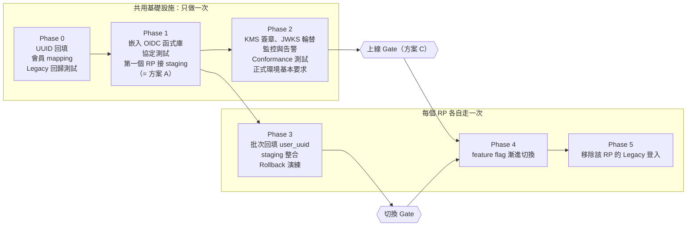
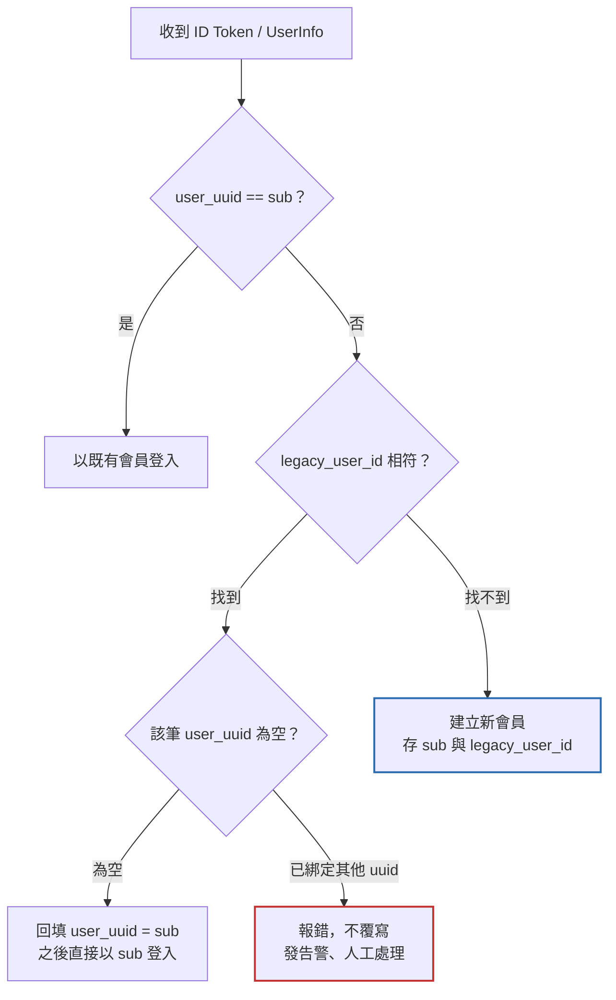

# OIDC Auth Server 決策紀錄（提案）

2026-10-26 · 狀態：提案，待「定案前必須查證」各項確認後定案

## 背景

兩份構想文件回答的是不同問題，需要各選一個答案，而不是二選一。

| 文件 | 回答的問題 | 選項 |
| --- | --- | --- |
| `doc/idea_gemini.txt` | Provider 要用什麼做 | 1. Ory Hydra · 2. 嵌入函式庫 · 3. 自建 · 4. Keycloak |
| `doc/idea_gpt.txt` | 要怎麼上線 | A. MVP · B. Phase 0–5 分階段 · C. 生產級安全 · D. 跨產品登出 |

本文件把兩者合併成一個提案：實作方式選一個，上線流程選一條，並補上兩份文件遺漏的規則。

## 提案：嵌入成熟 OIDC 函式庫（方案 2），Hydra 為備案

實作採 Gemini 文件的方案 2：在現有後端嵌入成熟的 OIDC 函式庫；上線流程照 GPT 文件的 Phase 0–5，但調整 Gate 位置（見「上線路線」）。

- **和既定 PR 的矛盾：** Gemini 文件說 PR 規劃的是方案 3（自建），但 GPT 文件寫「使用標準 OIDC library」。這點要先定案，因為它決定每個 Phase 的工作量。
- **為什麼不自建：** 自建看似只有 5 個端點，但 PKCE、code 兌換、redirect URI 比對、nonce、錯誤回應都要自己寫、自己測。主要風險就在這些細節裡，函式庫已經做好了。
- **為什麼不用 Keycloak：** 太重，適合外部第三方生態系，不是目前的內部 RP 場景。
- **Hydra 是備案，不是被否決：** 真正的取捨是「多維運一個 Go 服務」對上「協定層由經 OpenID 認證的實作負責」。官方認證只涵蓋協定層，login/consent 串接、client 註冊、redirect URI 設定仍是自己的責任。如果現有後端無法嵌入函式庫（見下），Hydra 就是首選。

### 定案前必須查證

| 項目 | 為什麼重要 | 若不成立 |
| --- | --- | --- |
| 現有後端的語言與版本 | `UserData` 與 Cloud KMS 暗示是 GCP / Python，但若仍是 Python 2 / GAE 舊架構，Authlib（只支援 Python 3）無法嵌入 | 改採 Hydra，或另開獨立服務 |
| 函式庫能否接遠端 signer | 函式庫預設用記憶體中的私鑰簽章；要每次呼叫 KMS，就得覆寫 token 產生流程，等於把最敏感的部分改回自己寫 | 改用「KMS 加密金鑰、啟動時載入」（見「金鑰與簽章」），或換函式庫 |
| 函式庫是否支援 RP-Initiated Logout | 第一天就要（見「範圍」）。oidc-provider（Node，OpenID 認證）有 `end_session_endpoint`；Authlib 沒有內建，需要自己寫 | 自寫 logout 端點，列入 Phase 1 工作量 |

自建只保留給函式庫做不到的部分：signer 介接、會員查詢、自訂 claims，以及（若需要）logout 端點。

## 上線路線

照 GPT 文件的 Phase 0–5 推進，但有兩項調整：

- **第一個 RP 在 Phase 1 就接 staging。** 這就是方案 A（MVP）：越早用真實 RP 驗證越好，不必等正式環境加固完成。
- **上線 Gate 放在 Phase 4（正式切換）之前，而不是 Phase 3 之前。** 正式環境的安全條件，只需要在接正式流量前到位；各 RP 的 staging 整合可以和 Phase 2 平行進行。

上線 Gate 只需要通過一次；切換 Gate 每個 RP 各自通過。兩個都過了，該 RP 才能進入 Phase 4。

一個 RP 出問題只回復該 RP，不影響其他產品。每個 Phase 以可查驗的證據判定完成，不是以程式碼合併判定。

| Phase | 退出條件 |
| --- | --- |
| 0 | UUID 回填完成且唯一；Legacy 回歸測試通過 |
| 1 | 第一個 RP 在 staging 端到端登入成功；協定與負向測試通過 |
| 2 | KMS 簽章與 JWKS 輪替演練通過；Conformance Suite 通過；告警與 runbook 就緒；「正式環境基本要求」全部到位 |
| 3 | 該 RP 批次回填完成、衝突清單清空；舊會員、新會員、登入失敗情境通過；rollback 後仍是同一會員 |
| 4 | flag 依序開到內部帳號 → 小比例 → 全部，每一階登入成功率與 Token 兌換失敗率正常（門檻待定） |
| 5 | 該 RP 已無 Legacy 登入流量；移除 `legacy` scope |

### Phase 4 用 feature flag 漸進切換，而不是一次切換

一次全量切換時，任何問題都會同時影響所有使用者，回復也要重新部署。用 flag 依序開給內部帳號、小比例使用者、全部使用者，出問題時關掉 flag 就能回到 Legacy SSO。

## 金鑰與簽章

兩種做法都可行，實際選哪個取決於函式庫能否接遠端 signer（見「定案前必須查證」）。

| 做法 | 私鑰位置 | 代價 |
| --- | --- | --- |
| 每次簽章都呼叫 KMS | 不落地 | 登入頻率下延遲與費用都不大；但 KMS 不可用時無法登入，且需要函式庫支援遠端 signer |
| KMS 加密金鑰，啟動時載入記憶體 | process 記憶體 | 任何函式庫都能用；私鑰暴露面較大 |

不論選哪個，都需要：

- 可測試的 signer 介面（測試用本地金鑰，正式環境用 KMS）。
- JWKS 新舊金鑰重疊發布；RP 遇到未知 `kid` 重新取得 JWKS，驗證失敗一律拒絕。
- 明確選定簽章演算法（RS256 或 ES256），寫進 discovery 文件。

待查證：Hydra 與 Keycloak 是否支援直接用 Cloud KMS 簽章。印象中 Hydra 是把 JWK 加密後存在自己的資料庫，Gemini 文件寫的「內建 Cloud KMS 整合」需要確認。

## RP 會員對應

主方案是**切換前離線批次回填**，登入時的對應流程只當安全網。

### 主方案：Phase 3 批次回填

Phase 0 完成後，IdP 已經有完整的 `legacy_user_id → uuid` 對照表。每個 RP 切換前：

1. 從 IdP 匯出對照表，批次寫入 RP 會員表的 `user_uuid`。
2. 對不上的紀錄（RP 有 IdP 沒有、或已綁定不同 uuid）列成衝突清單，人工處理到清空。
3. 切換後，既有會員登入只走「用 `sub` 查 `user_uuid`」這一條路。

好處：衝突在上線前就浮現，而不是在使用者登入當下；登入路徑最簡單；`legacy_user_id` claim 可以更早移除。

### 安全網：登入時對應

處理批次回填之後、切換之前才出現的會員（例如這段期間新註冊的帳號）。

標色框是對 Gemini 文件原流程圖的補正。

1. 先用 `sub` 找 `user_uuid`，找到就登入。
2. 找不到再用 `legacy_user_id` 找；找到且該筆 `user_uuid` 為空，就回填。
3. **補正：** 找到但 `user_uuid` 已是**不同**的值 → 報錯並告警，絕不覆寫或自動合併。
4. **補正：** 都找不到 → 建立新會員，**同時寫入 `user_uuid` 和 `legacy_user_id`**。否則 OIDC 期間新註冊的會員，在 rollback 後就會消失。
5. **補正：** `user_uuid` 與 `legacy_user_id` 都加唯一性約束，避免兩個首次登入同時建出重複會員。

### IdP 端的帳號合併與刪除

IdP 合併兩個帳號後，RP 端兩筆紀錄的 `sub` 對應會改變，這是「已綁定其他 uuid」衝突最可能的實際來源。遷移期間的規則：

- 從 Phase 3 批次回填開始，到所有 RP 完成 Phase 5 為止，**凍結帳號合併**；確有需要時走人工流程，並手動通知受影響的 RP。
- 遷移完成後的長期做法（帳號異動通知 RP）屬於方案 D 的 Event Bus，另立專案。

## legacy_user_id 的生命週期

`legacy_user_id` 是過渡用的 claim，必須有移除計畫，否則會變成永久耦合。改用批次回填後，它只是安全網，可以更早移除。

- 放在獨立的 scope（例如 `legacy`），只開放給正在遷移的 RP 申請。
- 新的 RP 一開始就只用 `sub`，不給 `legacy` scope。
- 每個 RP 完成 Phase 5 後，從它的 client 設定移除 `legacy` scope。
- 所有 RP 都完成後，整個停用這個 claim。移除日期：待定。

## 範圍：哪些第一天做、哪些延後

方案 D 整體延後，但兩項成本很低的登出基礎第一天就做，因為產品團隊上線第一週就會問「要怎麼登出？」。

| 功能 | 時程 | 理由 |
| --- | --- | --- |
| ID Token 帶 `sid` | 第一天 | 成本低；之後做 Back-Channel Logout 不必改 token 格式 |
| RP-Initiated Logout（`end_session_endpoint`） | 第一天 | 產品一定會問；oidc-provider 內建，Authlib 需自寫 |
| Back-Channel Logout | 延後 | 需要重送、失敗處理、各 RP 後端配合 |
| Session 同步、Token 撤銷 | 延後 | 另立專案 |
| 帳號切換、跨裝置登出 | 延後 | 另立專案 |
| 帳號異動 Event Bus | 延後 | 另立專案 |

## 正式環境基本要求

這些是上線 Gate 的一部分，兩份構想文件都沒列。

- **可用性：** IdP 掛掉，所有產品都無法登入。需要訂 SLO、部署多個實例，並為 KMS 或資料庫故障定義降級與告警。
- **登入頁防護：** CSRF、clickjacking（`frame-ancestors`）、session fixation（登入後換新 session id）。
- **速率限制：** token 端點與登入端點。
- **Client secret：** 存在 Secret Manager，可輪替，不寫在 RP 程式碼或設定檔裡。
- **Token 有效期限：** authorization code 600 秒（沿用構想文件）；ID Token、access token 的期限要明訂。
- **稽核紀錄：** 登入、token 簽發、衝突、管理操作都要留紀錄。

## 待釐清的協定細節

兩份文件都沒提到以下問題，Phase 1 開始前要有答案。

- [ ] `nonce`：Provider 要原樣寫入 ID Token，RP 要驗證。
- [ ] Refresh token 是否在這次範圍內？
- [ ] Access token 用 opaque 還是 JWT？（影響 UserInfo 驗證方式與撤銷能力）
- [ ] `redirect_uri` 是否嚴格完全比對（建議：是，不允許萬用字元）。
- [ ] `prompt=login`、`max_age` 的行為。
- [ ] Public client（SPA / 行動 App）是否只用 PKCE、不帶 client secret。

## 下一步

- [ ] 查證現有後端語言與版本，以及候選函式庫的遠端 signer 與 logout 支援，據此在方案 2 與 Hydra 之間定案。
- [ ] 和 PR 作者對齊：從自建（方案 3）改為嵌入函式庫（或 Hydra）。
- [ ] 決定 KMS 簽章做法。
- [ ] 確認遷移期間凍結帳號合併的流程與負責人。
- [ ] 設計 Phase 3 批次回填腳本與衝突清單格式。
- [ ] 決定 `legacy_user_id` 的移除日期。
- [ ] 回答「待釐清的協定細節」的問題。
- [ ] 整理原始構想文件：修正 `idea_gemini.txt` 比較表的 ` ` 斷行；刪除 `idea_gpt.txt` 最後一行誤貼的 ChatGPT 建議追問；移除不必要的 Redis Lua Script 建議（`GETDEL` 本身就是原子操作，或改用資料庫交易）。
