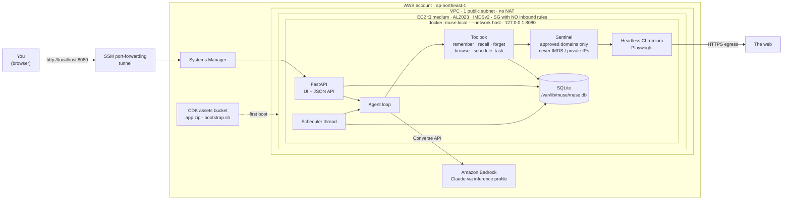
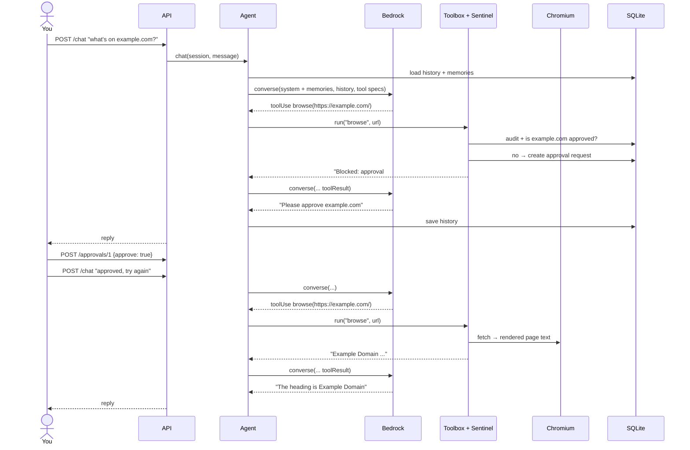
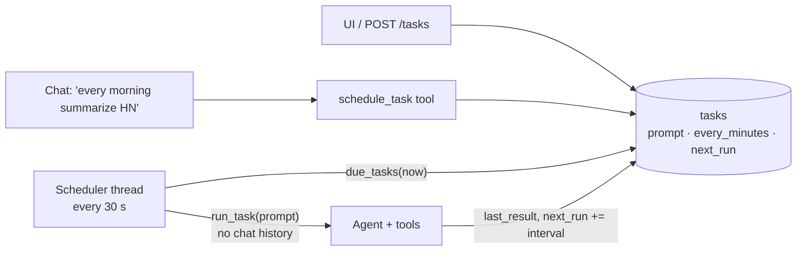

# muse-test-1 — a single-EC2 "agent box"

Approach A of [`doc/build-your-own-muse.md`](doc/build-your-own-muse.md): a
Meta-Muse-style personal AI agent on **one EC2 instance**. It's for a single
user, and its purpose is to find out whether the agent is actually useful
before we spend on anything bigger.

## Quick start

```bash
npm install && npx cdk deploy                    # ~3 min stack + ~2 min first-boot image build

# open the tunnel (keep it running), then browse http://localhost:8080
INSTANCE_ID=$(aws cloudformation describe-stacks --stack-name MuseTest1Stack \
  --query "Stacks[0].Outputs[?OutputKey=='InstanceId'].OutputValue" --output text)
aws ssm start-session --target "$INSTANCE_ID" \
  --document-name AWS-StartPortForwardingSession --parameters portNumber=8080,localPortNumber=8080

npm run test:e2e                                 # deployed-stack tests through their own tunnel
npx cdk destroy MuseTest1Stack                   # tear down (~$1/day while running)
```

The tunnel needs the
[session-manager-plugin](https://docs.aws.amazon.com/systems-manager/latest/userguide/session-manager-working-with-install-plugin.html).
Without sudo on macOS, you can unzip the `mac_arm64/sessionmanager-bundle.zip` and copy
`bin/session-manager-plugin` onto your `PATH`.

## System design

### Architecture



### What CDK deploys

| Resource | Setting | Why |
|---|---|---|
| VPC | 1 AZ, 1 public subnet, no NAT gateway | The box only needs egress, and a public IP is cheaper than a NAT gateway |
| Security group | **No ingress rules**, all egress allowed | Nothing on the internet can reach the box |
| EC2 instance | t3.medium, AL2023, 30 GB gp3 encrypted, IMDSv2 required | Enough RAM for Chromium; EBS encrypted at rest |
| IAM role | SSM core + `bedrock:InvokeModel` on **one** inference profile and its model | Least privilege; the configured model is the only one it can call |
| S3 assets | `app/` (without tests and venv) + `assets/bootstrap.sh` | The box builds the image itself on first boot |
| User data | Writes `/etc/muse/muse.env`, runs the bootstrap | `docker build` → systemd `muse.service` → waits for `/health` |

### Chat request, with the sentinel and approval



The agent loop is capped at 8 model calls per turn. A tool error goes back to
the model as text instead of crashing the request. An empty or refused model
response becomes a short explanation, so the session stays valid.

### Background tasks



### Data model (one SQLite file)

| Table | Holds | Written by |
|---|---|---|
| `memories` | Facts about the user, all of them included in every system prompt | `remember` tool, UI |
| `history` | Converse messages per session, trimmed to start on a user turn | Agent |
| `tasks` | Prompt, interval, next run, last result | `schedule_task` tool, UI, scheduler |
| `approvals` | Domain, `pending` / `approved` / `denied` | Sentinel, UI |
| `audit` | Every tool call (name + input) and every approval decision | Toolbox, API |

### App modules

| Module | Responsibility |
|---|---|
| `muse/api.py` | FastAPI routes + UI; wires everything up in `build()`; sync endpoints so Playwright runs in the thread pool |
| `muse/agent.py` | Tool loop over the Bedrock Converse API; system prompt with memories; history trimming |
| `muse/tools.py` | Tool specs + handlers; the sentinel's URL rules |
| `muse/browser.py` | One headless Chromium per fetch → title + body text, truncated |
| `muse/scheduler.py` | Daemon thread that runs due tasks |
| `muse/store.py` | All SQLite access behind one lock |
| `muse/llm.py`, `muse/config.py` | Bedrock client; environment config |

## Muse features covered

| Muse feature (doc §2) | Here |
|---|---|
| Long-term memory, editable | `remember`/`recall`/`forget` tools; every memory goes into the system prompt; Memories panel |
| Own browser | `browse` → Playwright Chromium, rendered text |
| Sentinel + approvals | Unknown domain → approval request; user allows/denies in the UI; link-local (IMDS) and private addresses are always refused |
| Background tasks | `schedule_task` → SQLite; scheduler thread runs due tasks through the agent |
| Audit trail | Every tool call and approval is logged; Audit panel |
| Access | No ingress at all; SSM port forwarding is the only way in |

## Layout

```
bin/, lib/            CDK app (TypeScript): VPC, security group, IAM role, EC2, assets
assets/bootstrap.sh   host setup: docker build + systemd unit
app/                  the agent (Python, managed with uv)
  muse/               store · tools · agent · llm · browser · scheduler · api · static/index.html
  tests/unit/         one file per module, model + browser faked
  tests/integration/  API end-to-end, real Chromium, live Bedrock, deployed stack
scripts/e2e-test.sh   deployed tests through an SSM tunnel
test/                 CDK unit tests (Jest)
```

## Tests

TDD throughout: each feature has unit tests and an integration test.

| Command | What | Needs |
|---|---|---|
| `npm test` | CDK assertions (network, IMDSv2, IAM scope, user data, outputs) | — |
| `npm run test:app` | Python unit tests + API integration + real headless Chromium | `cd app && uv sync && uv run playwright install chromium` |
| `npm run test:live` | Agent against real Bedrock (uses `remember`, answers from memory) | AWS creds |
| `npm run test:e2e` | Deployed stack through an SSM tunnel: health, UI, memory, chat→Bedrock, sentinel | deployed stack, [session-manager-plugin](https://docs.aws.amazon.com/systems-manager/latest/userguide/session-manager-working-with-install-plugin.html) |
| `npm run test:all` | `npm test` + `test:app` | |

## Operate

Deploy options: `npx cdk deploy -c bedrockModelId=jp.anthropic.claude-haiku-5-5 -c allowedDomains=wikipedia.org,news.ycombinator.com`

Run locally without AWS infra (still calls Bedrock with your credentials):

```bash
cd app && uv sync && uv run playwright install chromium
MUSE_DB=./muse.db AWS_REGION=ap-northeast-1 uv run python -m muse.api
```

Shell on the box: `aws ssm start-session --target "$INSTANCE_ID"`, then
`journalctl -u muse -f` or `sudo docker logs -f muse`.

Config (`/etc/muse/muse.env`): `MUSE_MODEL_ID` (default
`global.anthropic.claude-sonnet-5-5`, an inference profile), `MUSE_ALLOWED_DOMAINS`,
`MUSE_SCHEDULER_SECONDS`.

## Known limits (by design, for Approach A)

- **One user, no login.** The tunnel is the authentication.
- **State resets on release.** A changed app or bootstrap replaces the instance
  (`userDataCausesReplacement`), and SQLite goes with it. Back up
  `/var/lib/muse/muse.db` first if you care about it.
- **The agent and its credentials share a host.** The sentinel checks URLs
  before Chromium loads them, but the container can still reach the instance
  role. Approach B and later separate the browser from the agent at the network level.
- **Simple memory search.** Keyword matching, no embeddings. That is fine at
  this scale, because every memory goes into the prompt anyway.
- No connectors (Gmail/Calendar), payments or push notifications yet.

Tear down: `npx cdk destroy MuseTest1Stack`.
