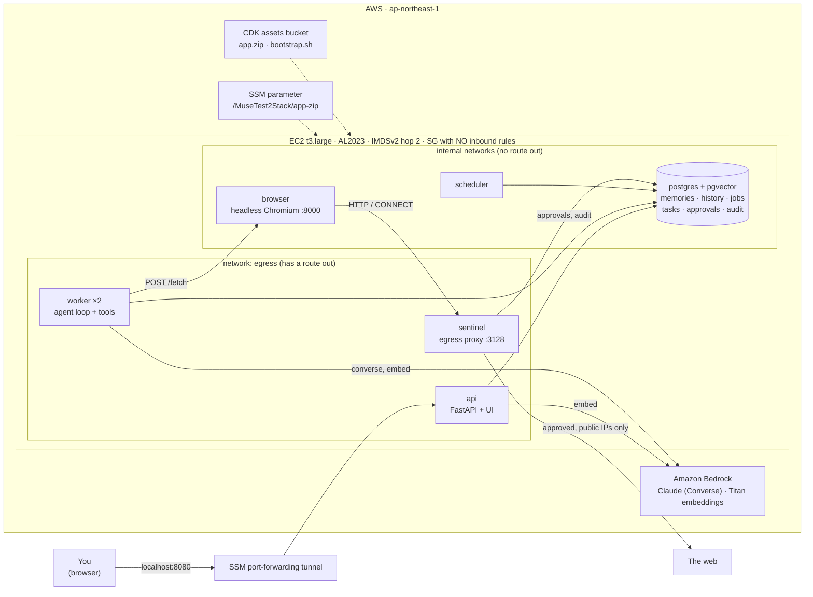
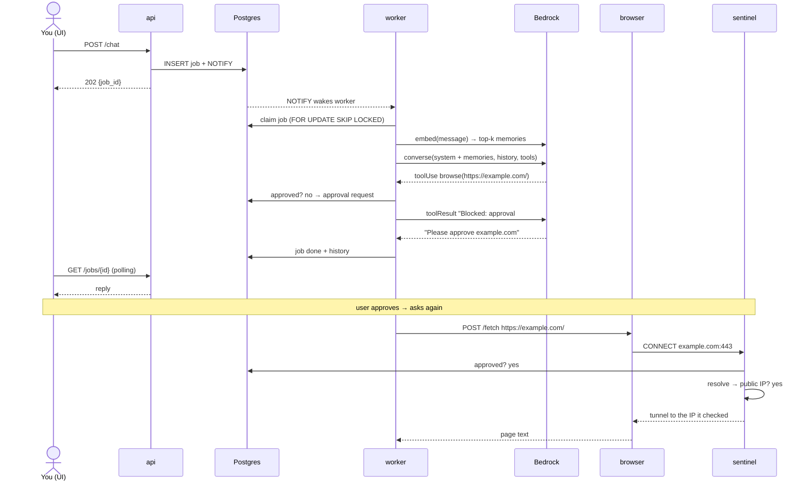
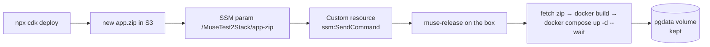

# muse-test-2 — EC2 + Docker Compose (separated services)

Approach B of [`doc/build-your-own-muse.md`](doc/build-your-own-muse.md). This is
the same Muse-style personal agent as [`muse-test-1`](../muse-test-1), split into
services, so that **the agent, the browser and the egress sentinel are separated
on the network** and work runs on a durable queue.

## Quick start

```bash
npm install && npx cdk deploy                    # ~3 min stack + ~6 min first-boot image build

# open the tunnel (keep it running), then browse http://localhost:8080
INSTANCE_ID=$(aws cloudformation describe-stacks --stack-name MuseTest2Stack \
  --query "Stacks[0].Outputs[?OutputKey=='InstanceId'].OutputValue" --output text)
aws ssm start-session --target "$INSTANCE_ID" \
  --document-name AWS-StartPortForwardingSession --parameters portNumber=8080,localPortNumber=8080

npm run test:e2e                                 # deployed-stack tests through their own tunnel
npx cdk destroy MuseTest2Stack                   # tear down (~$2.5/day while running)
```

You can run the same stack on your laptop: Docker plus AWS credentials, with real Bedrock.

```bash
cd app
export POSTGRES_PASSWORD=dev AWS_REGION=ap-northeast-1
eval "$(aws configure export-credentials --format env)"
docker compose -f compose.yaml -f compose.local.yaml up --build     # http://localhost:8080
```

## What changed from v1

| | v1 (`muse-test-1`) | v2 (this) |
|---|---|---|
| Processes | one container | 6 services: `api`, `worker` ×2, `scheduler`, `sentinel`, `browser`, `postgres` |
| Browser egress | the same process as the agent; URL check in code | separate container whose **only** route out is the sentinel proxy |
| Sentinel | function call | network proxy: approved domain + web port + public IP, checked on the resolved address |
| Chat | synchronous HTTP | queued job (`202` + poll); survives client disconnects |
| Background tasks | thread in the app | scheduler enqueues jobs; any worker runs them; stale jobs requeued |
| Memory | SQLite, keyword match, all memories in the prompt | Postgres + **pgvector**, Titan embeddings, top-k relevant memories in the prompt |
| Release | replaces the instance, so state is lost | `cdk deploy` runs `muse-release` over SSM, so **Postgres survives** |

**Deviations from the doc:**
- **The queue is Postgres** (`FOR UPDATE SKIP LOCKED` + `LISTEN/NOTIFY`), not Redis. That means one service fewer, and a job commits in the same database as the history and memories it writes.
- **No credential vault yet.** The doc's form-filling vault sidecar is left for later.

## System design

### Architecture



### Network isolation (`app/compose.yaml`)

| Service | backend | browse | sandbox | egress | Gets DB URL / AWS creds |
|---|:-:|:-:|:-:|:-:|:-:|
| postgres | ✓ | | | | — |
| api | ✓ | | | ✓ | ✓ / ✓ (embeddings) |
| worker ×2 | ✓ | ✓ | | ✓ | ✓ / ✓ |
| scheduler | ✓ | | | | ✓ / – |
| sentinel | ✓ | | ✓ | ✓ | ✓ / – |
| **browser** | | ✓ | ✓ | | **– / –** |

`backend`, `browse` and `sandbox` are `internal: true`. So the browser, which loads
attacker-controlled pages, can reach only the worker (which calls it) and the
sentinel. It has no direct internet, no Postgres, no IMDS and no secrets. The
compose test proves each of these.

### Chat request



**The worker asks and the sentinel enforces.** The worker only *explains* blocks and
files approval requests. The sentinel independently checks every connection,
including the page's sub-resources, and connects to the exact IP it validated.
That means DNS rebinding can't reach the VPC or IMDS (`169.254.169.254` is refused
even when it's approved).

### Release path (state survives deploys)



User data never references the app zip, so an app change never replaces the
instance. Only a change to `assets/bootstrap.sh` or the stack config does.

### What CDK deploys

| Resource | Setting |
|---|---|
| VPC | 1 AZ, 1 public subnet, no NAT |
| Security group | **no ingress**, all egress |
| EC2 | t3.large, AL2023, 40 GB gp3 encrypted, IMDSv2 required, hop limit 2 |
| IAM role | SSM core; `bedrock:InvokeModel` on the chat inference profile + model and the Titan model; read the app param and asset |
| SSM parameter | `/<stack>/app-zip`, the S3 URL of the current release |
| Custom resource | on app change: `ssm:SendCommand muse-release` (ignores a box that is still booting) |

### App modules (`app/muse/`)

| Module | Runs as | Responsibility |
|---|---|---|
| `api.py` | `api` | REST + UI; chat → job |
| `worker.py` | `worker` | claim job → agent → finish; NOTIFY-driven |
| `agent.py`, `tools.py` | `worker` | Converse tool loop; remember / recall / forget / browse / schedule_task |
| `scheduler.py` | `scheduler` | due tasks → jobs; requeue jobs from dead workers |
| `sentinel.py` | `sentinel` | asyncio HTTP/CONNECT proxy enforcing `policy.py` |
| `browser.py` | `browser` | Playwright service (fresh context per fetch) + `BrowserClient` |
| `store.py` | all | Postgres schema, pgvector, queue, approvals, audit |
| `llm.py`, `config.py`, `policy.py` | shared | Bedrock clients, environment config, egress rules |

## Tests

Every layer was test-driven. Postgres in tests is a real throwaway pgvector container.

| Command | Covers | Needs |
|---|---|---|
| `npm test` | CDK: network, IMDS, IAM scope, user data stability, release custom resource, outputs | — |
| `npm run test:app` | unit (store, policy, tools, agent, worker, scheduler, sentinel decisions) + integration (API flows, real sentinel proxy, real Chromium behind it) | Docker, `uv run playwright install chromium` |
| `npm run test:live` | real Claude + Titan: semantic recall, remember/answer | AWS creds |
| `npm run test:compose` | the whole compose stack locally + **isolation proofs** | Docker, AWS creds |
| `npm run test:e2e` | the deployed stack through an SSM tunnel (same contract as compose) | deployed stack, session-manager-plugin |

## Operate

- Logs: `aws ssm start-session --target "$INSTANCE_ID"`, then `cd /opt/muse/current && sudo docker compose logs -f worker`.
- Re-run a release by hand: the `ReleaseCommand` stack output.
- Config: `/etc/muse/muse.env` (`MUSE_MODEL_ID`, `MUSE_EMBED_MODEL_ID`, `MUSE_ALLOWED_DOMAINS`, generated `POSTGRES_PASSWORD`).
- Deploy options: `npx cdk deploy -c bedrockModelId=jp.anthropic.claude-haiku-5-5 -c allowedDomains=wikipedia.org`.

## Known limits

- **Still one host and one user.** There's no HA, and the tunnel is the authentication.
- **Containers share a kernel.** That's fine for separating one user's components, but it isn't multi-tenant isolation (Approach D/E).
- **The Postgres volume lives on the root disk.** It survives releases but not a bootstrap change or `cdk destroy`.
- **No credential vault, connectors or payments yet.**
