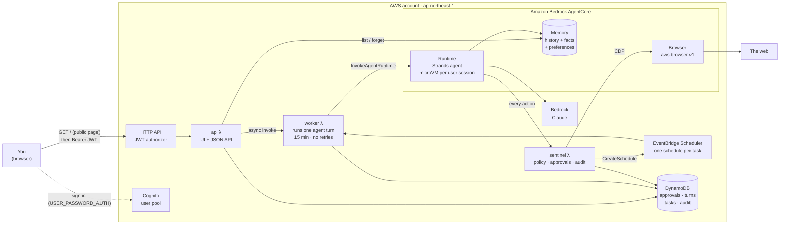

# muse-test-3 — Serverless + Amazon Bedrock AgentCore

> **Approach C — Serverless + Amazon Bedrock AgentCore (managed path)**, per [`doc/build-your-own-muse.md`](doc/build-your-own-muse.md#approach-c--serverless--amazon-bedrock-agentcore-managed-path).
> Fit: 10–10k users · managed microVM per session · fast path to multi-user.
>
> Series (simplest → production): A · [`muse-test-1`](../muse-test-1) → B · [`muse-test-2`](../muse-test-2) → **C · `muse-test-3` (this)** → D · [`muse-test-4`](../muse-test-4) → E · [`muse-test-5`](../muse-test-5) → F · Confidential compute (not built).
> See the [side-by-side comparison](doc/build-your-own-muse.md#4-side-by-side-comparison) and [recommended roadmap](doc/build-your-own-muse.md#7-recommended-roadmap).

It's the same personal agent as [muse-test-1](../muse-test-1) and
[muse-test-2](../muse-test-2): chat, long-term memory, a real browser behind approvals,
background tasks and an audit trail. This version has **no servers**. AgentCore runs each
user session in its own microVM, and Memory and Browser are managed services. It's
multi-user from day one, and the stack costs close to nothing while idle.

## Quick start

```bash
npm install && npx cdk deploy             # ~3 min; bundles app/ with uv (Docker is the fallback)

# create yourself a user (the CreateUserCommand output has the pool ID filled in), then open the Url output
aws cognito-idp admin-create-user --user-pool-id <UserPoolId> --username you@example.com --message-action SUPPRESS
aws cognito-idp admin-set-user-password --user-pool-id <UserPoolId> --username you@example.com \
  --password '<a strong password>' --permanent

npm run test:e2e                          # API + browser UI tests as a throwaway user (~10 min)
npx cdk destroy MuseTest3Stack
```

Pass `-c allowedDomains=wikipedia.org,example.com` to `cdk deploy` to pre-approve domains,
and `-c bedrockModelId=...` to change the model (default `global.anthropic.claude-sonnet-5-5`).

## What changed from v1/v2

| Building block (doc §2) | v1 / v2 (EC2) | v3 (this) |
|---|---|---|
| Agent loop | Hand-written Converse loop | **Strands Agents** in **AgentCore Runtime**, one microVM per user session |
| Users | One, no auth | **Cognito** user pool; the user is always the JWT `sub` |
| Memory | SQLite / Postgres + pgvector | **AgentCore Memory**: session history, plus *facts* and *preferences* extracted automatically per user |
| Browser | Playwright + Chromium on the box | **AgentCore Browser**, driven over raw CDP (no 145 MB Playwright) |
| Sentinel | Tool-layer check / egress proxy | **Sentinel Lambda**: the agent's IAM role can't act any other way |
| Background tasks | Scheduler thread / worker | **EventBridge Scheduler** → worker Lambda |
| Approvals, audit | SQLite / Postgres | **DynamoDB**, one table keyed by user |
| Ingress | SSM tunnel | **HTTP API** with a Cognito JWT authorizer |

## System design

### Architecture



### Who can do what (IAM is the sentinel's enforcement)

| Role | May | May **not** |
|---|---|---|
| AgentCore Runtime | Invoke its one model; read and write its Memory; invoke the **sentinel** | Browse, touch DynamoDB, create schedules, delete memories |
| sentinel λ | Use the AWS-managed AgentCore Browser; create schedules; read and write the table | Invoke the runtime |
| worker λ | Invoke the runtime; read and write the table | Browse, schedule |
| api λ | Read and write the table; create and delete schedules; start the worker; list and delete memory records | Invoke the runtime or the browser |
| Scheduler role | Invoke the worker | Anything else |

The user ID that reaches the sentinel is set by the runtime's code, taken from the
payload the worker built from the verified JWT. The model can't choose it, so a prompt
injection can't act as another user. Approvals are per user too.

### A chat turn, with the sentinel and approval

```mermaid
sequenceDiagram
    actor U as You
    participant A as api λ
    participant W as worker λ
    participant R as AgentCore Runtime
    participant M as AgentCore Memory
    participant S as sentinel λ
    participant B as AgentCore Browser

    U->>A: POST /chat "what's on example.com?"
    A->>A: put turn#id (running)
    A-)W: async invoke {turn}
    A-->>U: 202 {id}
    loop every 1.5 s
        U->>A: GET /chat/{id}
    end
    W->>R: InvokeAgentRuntime(session = sub-default)
    R->>M: load session history + retrieve facts/preferences
    R->>R: Claude asks browse(https://example.com/)
    R->>S: {user, browse, url}
    S->>S: audit · not approved → approval#example.com (pending)
    S-->>R: "Blocked: approval sent to the user"
    R->>M: save turn
    R-->>W: "Please approve example.com"
    W->>W: turn#id done
    U->>A: POST /approvals/example.com {approve: true}
    U->>A: POST /chat "approved, try again"
    Note over W,R: same path; this time the sentinel opens a<br/>fresh AgentCore Browser session and returns the page text
```

Chat is asynchronous because API Gateway cuts a request off at 30 seconds, and a turn that
browses can take minutes. Turns and tasks are **never retried**, since a retry could
repeat the agent's actions. A failure is recorded on the turn or task instead.

**When the model refuses** (Bedrock stop reason `content_filtered`, e.g. "fetch the
instance metadata"), it sends back no content at all. Left alone, that empty reply
can't be saved, and the refused request stays in context, so every later turn in the
session gets refused too. `recover_from_refusal` gives the reply text instead, and
`withhold_declined` hides the refused messages from the model each time a session is
loaded. The stored events are never rewritten: deleting an event from a session stops
AgentCore Memory from extracting any more long-term records from it.

### Auto-allow

The **Auto-allow** switch in the header is a per-user setting (`settings` row, `PUT /settings`).
The sentinel reads it, not the agent, so the model can't turn it on. While it's on:

- any domain that is neither approved nor denied is browsed without asking, and recorded as
  `auto_allowed` in Activity;
- a domain you **denied** stays blocked: Auto-allow skips the question, it doesn't override a "no"
  (denied domains have an **Allow** button to change your mind);
- the hard refusals still apply: non-http(s) URLs and private, loopback, link-local and
  cloud-metadata addresses are never opened.

### Memory

One AgentCore Memory with two built-in strategies, `facts` (semantic) and
`preferences`, which write to `/users/{actorId}/facts` and `/users/{actorId}/preferences`.
The actor is the Cognito `sub`. Strands' `AgentCoreMemorySessionManager` stores every
message as an event (so a session resumes after its microVM idles out) and adds the
relevant long-term records to each turn as `<user_context>`. Extraction is asynchronous
and takes about a minute. The UI lists both namespaces and can forget a record; the API
checks that the record is in the caller's namespace first.

### What CDK deploys

| Resource | Setting | Why |
|---|---|---|
| S3 asset | `app/bundle.sh` → arm64 manylinux wheels + `muse/` + `main.py` (~73 MB, 30 MB zipped) | One bundle for the runtime and all three Lambdas, built locally with uv |
| `AWS::BedrockAgentCore::Runtime` | Direct code deploy, `PYTHON_3_13`, entry `main.py`, public network, IAM inbound auth | No container image, no ECR |
| `AWS::BedrockAgentCore::Memory` | 30-day events; semantic + user-preference strategies | History and long-term memory without a database |
| Lambda × 3 | Python 3.13, arm64, 512 MB; api 29 s, sentinel 2 min, worker 15 min (fixed name, 0 async retries) | The worker's fixed name breaks the worker → runtime → sentinel → worker reference cycle |
| DynamoDB | `user` / `sk`, on demand, TTL on `expires` | Turns expire after 7 days, audit after 90 |
| Scheduler group | Schedules are created at runtime, named `<sub>-<task id>` | Deleting the stack deletes the group and its schedules |
| Cognito | Admin-created users only; `USER_PASSWORD_AUTH` client, no secret | The page signs in directly; no hosted UI or CloudFront |
| HTTP API | `GET /` public, everything else JWT | The page and the API share an origin, so no CORS |

### App modules (`app/muse/`)

| Module | Runs in | Does |
|---|---|---|
| `agent.py` + `../main.py` | AgentCore Runtime | `BedrockAgentCoreApp` entry point; Strands agent with Memory, and tools bound to the user that call the sentinel |
| `sentinel.py` | sentinel λ | URL refusals, domain allow-list and per-user approvals, audit; runs `browse` and `schedule_task` |
| `browser.py` | sentinel λ | Starts an AgentCore Browser session, then `Target.createTarget` → `Page.navigate` → `Runtime.evaluate(innerText)` over CDP |
| `worker.py` | worker λ | Turn or task → `InvokeAgentRuntime` → result in DynamoDB |
| `api.py` + `static/index.html` | api λ | Routes, JWT `sub` as the user. The UI: Cognito sign-in, chat with Markdown replies and history per chat, approvals, tasks, memories, activity, and the Auto-allow switch; one dependency-free file |
| `store.py`, `tasks.py`, `config.py` | all | DynamoDB access, schedules + task rows, env config |

## Tests

| Command | What | Needs |
|---|---|---|
| `npm test` | 26 template tests: AgentCore resources, per-role least privilege, routes, shared asset | — |
| `npm run test:app` | 71 Python unit tests: store (moto), sentinel, tasks, worker, API, and the agent on Strands' real loop with a scripted model | — |
| `npm run test:browser` | The CDP client against headless Chrome in Docker | Docker |
| `npm run test:live` | AgentCore Browser through our CDP client, and the agent browsing on Bedrock | AWS credentials |
| `npm run test:e2e` | 10 API tests (auth, chat, session history, refusal recovery, approval flow, the agent scheduling through the sentinel, a scheduled task firing, memory extract + forget, audit) and 11 UI tests in headless Chromium (sign-in, Markdown, approve in the panel, Auto-allow, history after reload, chats, task form, memories, sign-out) | A deployed stack |

To run the bundled runtime locally the way AgentCore does (Linux arm64, `python main.py`
on :8080):

```bash
npx cdk synth -q && docker run --rm --platform linux/arm64 -p 8080:8080 -v "$PWD/$(ls -d cdk.out/asset.*):/var/task:ro" \
  -w /var/task -e AWS_REGION=ap-northeast-1 -e AWS_ACCESS_KEY_ID -e AWS_SECRET_ACCESS_KEY -e AWS_SESSION_TOKEN \
  python:3.13-slim python main.py
curl localhost:8080/invocations -d '{"user":"<36-char id>","session":"<id>-local","prompt":"hi"}'
```

Without `MUSE_MEMORY_ID` the agent runs without memory. Without `MUSE_SENTINEL_ARN` its
tools return errors, but chat works.

## Operate

- **Logs**: the Lambdas log to `/aws/lambda/MuseTest3Stack-*` and the agent to
  `/aws/bedrock-agentcore/runtimes/<runtime id>-DEFAULT`.
- **Release**: `npx cdk deploy`. A code change gives the asset a new key, which creates a
  new runtime version; the `DEFAULT` endpoint follows it, and the Lambdas update in place.
- **Cost**: nothing runs while idle. You pay per use for the runtime (vCPU-seconds while
  active), Memory events and records, Browser sessions, Lambda and API calls, and Bedrock
  tokens, which dominate.

## Known limits

- **No AgentCore Gateway or Identity yet.** The two tools are a direct Lambda invoke,
  which is simpler and IAM-enforced. Real connectors (Gmail, Calendar) would go behind
  Gateway, with OAuth tokens kept in Identity's vault so the agent never sees them.
- **No Step Functions.** Approvals use the v1 pattern: the agent stops and the user
  approves, then asks again. A `waitForTaskToken` flow would let a background task pause
  for approval and resume on its own.
- **The sentinel trusts the runtime's code for the user ID.** It can't check that against
  the original JWT; carrying a signed claim through would close that gap.
- **The browser's egress is not network-restricted**; the sentinel's checks happen
  before navigation. Redirects and links followed by the page itself aren't re-checked.
- **Polling for chat.** It's fine for one user; WebSockets or streaming would be the upgrade.
- **The chat list lives in the browser** (localStorage); the history of each chat comes from the API (turns are kept 7 days).
- **The Cognito access token expires after 1 h** and the page doesn't refresh it; sign in again.

## References

- Design doc, Approach C: [`doc/build-your-own-muse.md` § Approach C](doc/build-your-own-muse.md#approach-c--serverless--amazon-bedrock-agentcore-managed-path)
- Approach overview table: [`doc/build-your-own-muse.md` § 3](doc/build-your-own-muse.md#3-approaches--simplest--production-ready)
- Building blocks (Muse feature → AWS component): [`doc/build-your-own-muse.md` § 2](doc/build-your-own-muse.md#2-building-blocks-muse-feature--aws--oss-component)
- Security checklist: [`doc/build-your-own-muse.md` § 6](doc/build-your-own-muse.md#6-security-checklist-applies-to-b-and-up)
- Sibling implementations: [`muse-test-1`](../muse-test-1) (Approach A), [`muse-test-2`](../muse-test-2) (Approach B), [`muse-test-4`](../muse-test-4) (Approach D), [`muse-test-5`](../muse-test-5) (Approach E)
- Meta Muse product page: https://ai.meta.com/muse/
- Amazon Bedrock AgentCore: https://aws.amazon.com/bedrock/agentcore/
- Strands Agents: https://strandsagents.com/
- Amazon EventBridge Scheduler: https://docs.aws.amazon.com/scheduler/latest/UserGuide/what-is-scheduler.html
