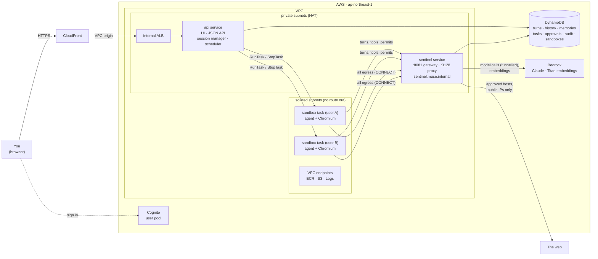
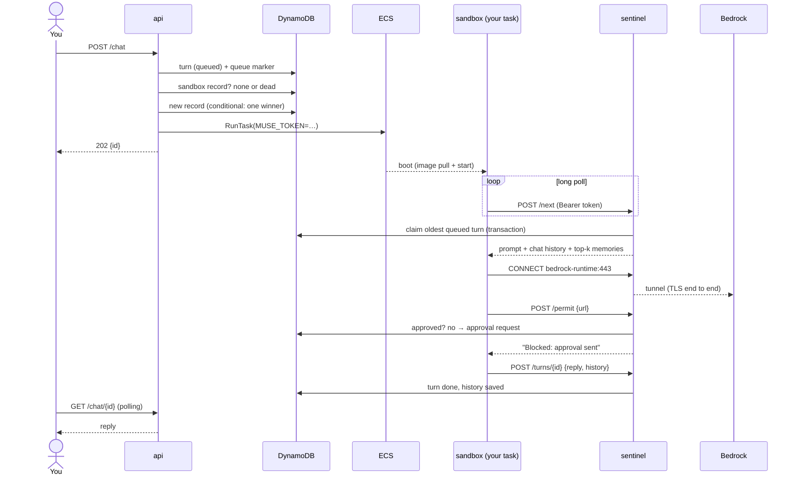

# muse-test-4 — ECS Fargate, a sandbox task per user

Approach D of [`doc/build-your-own-muse.md`](doc/build-your-own-muse.md). It's the same
personal agent as [muse-test-1](../muse-test-1), [-2](../muse-test-2) and [-3](../muse-test-3):
chat, long-term memory, a real browser behind approvals, background tasks and an audit trail.
This time **every active user gets their own Fargate task** (a Firecracker microVM) that runs
the agent and its Chromium. That task sits in a subnet with **no route out**: the only thing it
can reach is the sentinel, which gates every connection and every stateful action for that user.

## Quick start

```bash
npm install && npx cdk deploy              # ~10 min: builds the arm64 image locally with Docker

# create yourself a user (the CreateUserCommand output has the pool ID filled in), then open the Url output
aws cognito-idp admin-create-user --user-pool-id <UserPoolId> --username you@example.com --message-action SUPPRESS
aws cognito-idp admin-set-user-password --user-pool-id <UserPoolId> --username you@example.com \
  --password '<a strong password>' --permanent

npm run test:e2e                           # API tests as a throwaway user
npx cdk destroy MuseTest4Stack
```

Pass these to `cdk deploy` as needed:

- `-c allowedDomains=wikipedia.org,example.com` pre-approves domains for everyone.
- `-c bedrockModelId=...` changes the model (the default is `global.anthropic.claude-sonnet-5-5`).
- `-c idleMinutes=5` sets how long an idle sandbox lives (the default is 10).

### Run it all on your laptop

It's the same image and the same isolation, with Docker in place of Fargate and DynamoDB Local
in place of DynamoDB. The api starts one sandbox container per user through the Docker socket,
on an internal network where the sentinel is the only peer.

```bash
cd app
export AWS_REGION=ap-northeast-1; eval "$(aws configure export-credentials --format env)"
docker compose up --build                  # http://localhost:8080; any name signs you in (no Cognito locally)
docker ps --filter label=muse.sandbox      # one container per active user; each exits after MUSE_IDLE_SECONDS
```

## What changed from v1–v3

| Building block (doc §2) | v2 (EC2 + Compose) | v3 (AgentCore) | v4 (this) |
|---|---|---|---|
| Isolation per user | none (one user) | AgentCore microVM per session | **Fargate task per user**, started on demand, stops itself when idle |
| Agent loop | Converse loop | Strands in AgentCore Runtime | Converse loop (v2's), in the sandbox |
| Browser | Chromium container | AgentCore Browser | Chromium **in the sandbox**, whose only route out is the sentinel |
| Sentinel | egress proxy | Lambda every tool goes through | **both**: the egress proxy *and* the gateway for every stateful tool, per user |
| Model access | instance role | runtime role | sandbox role (model only), reached **through the sentinel proxy** |
| State | Postgres + pgvector | DynamoDB + AgentCore Memory | one DynamoDB table; Titan embeddings ranked in the sentinel |
| Background tasks | scheduler service | EventBridge Scheduler | scheduler loop in the api + a sparse `due` index |
| Users / ingress | SSM tunnel | Cognito + HTTP API | Cognito + **CloudFront → internal ALB** (VPC origin) |

**Deviations from the doc:**

- **No Aurora.** Memory is DynamoDB. A user's memories are few, so ranking them by cosine similarity in the sentinel is enough, and the stack has no database to wait for, patch or pay for while idle.
- **No Step Functions.** A turn is a row in DynamoDB that the sandbox claims. Approvals use the v1 pattern: the agent stops and the user approves, then asks again.
- **The sandbox pulls; nothing pushes into it.** That means no inbound rules at all, and the session manager needs no reaper, because an idle sandbox signs off and exits.
- **One container per sandbox**, not agent + browser + credential sidecar. Containers in a task share a network namespace, so splitting them wouldn't add network isolation. There's no credential vault yet.
- **No warm pool or per-user KMS keys yet** (see Known limits).

## System design

### Architecture



### Who can reach and do what

| | Network | IAM role | Table |
|---|---|---|---|
| **sandbox** | out to the sentinel (3128, 8081) and the ECR/Logs/S3 endpoints that Fargate needs; **no inbound** | `bedrock:InvokeModel` on its one model | none |
| **sentinel** | in from sandboxes only; out through NAT | the table; Titan embeddings | read/write |
| **api** | in from the ALB only; out through NAT | the table; `ecs:RunTask` on the sandbox task definition, `ecs:StopTask`, `iam:PassRole` for its roles | read/write |
| **ALB** | in from CloudFront's origin-facing prefix list only | — | — |

The sandbox is where attacker-controlled pages run. It holds a role that can only call the
model, and a token that lets the sentinel act for *its one user*. It can't see the table,
the api, other sandboxes or the metadata endpoints, and the internet only reaches it
through the sentinel's rules.

### The sandbox token

When the api launches a sandbox it creates a token, `<user>.<random>`, passes it in the RunTask
environment override and stores only its SHA-256 in the user's `sandbox` record. The sentinel
accepts a request, on the gateway (`Authorization: Bearer`) or the proxy
(`Proxy-Authorization: Basic`), only while the token matches that user's *current* record.
That gives three guarantees:

- **The user is bound by infrastructure.** The model never chooses which user it acts as.
- **There's one live sandbox per user.** When a sandbox is replaced, the old one is locked out at once.
- **Model calls are authenticated too.** The sandbox's boto3 client uses the same proxy, with the token in the proxy URL.

### A chat turn



### Sandbox lifecycle

| State | Meaning | The api on your next message |
|---|---|---|
| `stopped` | there's no sandbox, or it signed off | starts one |
| `starting` | launched, no heartbeat yet (allowed 5 min) | waits |
| `running` | heartbeating every 15 s | queues the turn for it |
| `lost` | no heartbeat for 60 s, or never booted | fails its running turn, stops the task, starts a new one |

An idle sandbox (10 min by default) calls `/bye`. The sentinel marks it `stopped` and only
then checks the queue. The api queues a turn and only then reads the record. So either the
api sees `stopped` and starts a new sandbox, or the old one sees the turn and stays; no turn
is ever left waiting. Polling a waiting turn (`GET /chat/{id}`) also checks the sandbox, so a
crash heals while you watch.

### What CDK deploys

| Resource | Setting |
|---|---|
| VPC | 2 AZs; public, private (1 NAT) and **isolated** `sandbox` /22 subnets |
| VPC endpoints | interface: ECR API, ECR Docker, Logs (one AZ); gateway: S3 (isolated), DynamoDB (private) |
| ECS cluster | Cloud Map namespace `muse.internal` |
| Image | one arm64 asset (Python 3.13 + Playwright's headless Chromium), used by all three task definitions |
| `api` service | 0.5 vCPU / 1 GB, behind an internal ALB |
| `sentinel` service | 0.5 vCPU / 1 GB, registered as `sentinel.muse.internal` |
| `sandbox` task definition | 1 vCPU / 2 GB; never a service, only RunTask |
| DynamoDB | `user` / `sk`, sparse GSI `due` (`due`, `next_run`), TTL `expires` |
| Cognito | admin-created users; `USER_PASSWORD_AUTH` client with no secret |
| CloudFront | VPC origin → ALB, CachingDisabled, AllViewerExceptHostHeader |

### App modules (`app/muse/`)

| Module | Runs in | Does |
|---|---|---|
| `api.py`, `static/index.html` | api | Routes; the user is the access token's `sub`. The UI is v3's, plus a sandbox status chip and a local-mode sign-in |
| `sandboxes.py` | api | Session manager (`ensure`, liveness); `EcsLauncher` (RunTask) and `DockerLauncher` (local) |
| `scheduler.py` | api | Due tasks → queued turns, then `ensure` the user's sandbox |
| `auth.py` | api | Cognito JWT check (JWKS); `DevAuth` for local runs |
| `sentinel.py` | sentinel | Gateway (turns, tools, permits, heartbeat, bye), per-user policy, authenticated egress proxy |
| `sandbox.py` | sandbox | Pull loop, heartbeat, idle sign-off; gateway client; Chromium through the proxy |
| `agent.py` | sandbox | Converse tool loop; stateless (history and memories arrive with the turn) |
| `store.py` | api, sentinel | The one table: queue, sandboxes, memories, tasks, approvals, audit |
| `llm.py`, `config.py` | all | Bedrock clients; environment config |

## Tests

| Command | What | Needs |
|---|---|---|
| `npm test` | 21 template tests: isolated subnets have no routes, sandbox SG egress (exact list), least-privilege roles, CloudFront → internal ALB, env vars the app reads | — |
| `npm run test:app` | 74 Python unit tests: store (moto), the session manager and its races, the sentinel (gateway, policy, the real proxy), agent loop, sandbox runner, api, Cognito JWT checks | — |
| `npm run test:browser` | the sandbox's real Chromium through the real proxy (approved, blocked, wrong token) | local Chromium (installed by the script) |
| `npm run test:compose` | 16 tests on the whole stack in Docker with real Bedrock: chat, memory, approval flow, **isolation probes from inside a sandbox** (no internet, no DynamoDB, no api; the proxy's 407/403 rules), per-user sandboxes, idle sleep + wake, the UI | Docker, AWS credentials |
| `npm run test:e2e` | the deployed stack as a throwaway Cognito user: cold start, memory, approvals, a scheduled task running in the sandbox, audit | a deployed stack |

## Operate

- **Logs**: one log group (`LogGroup` output) with stream prefixes `api/`, `sentinel/` and `sandbox/`.
- **Who has a sandbox**: `aws ecs list-tasks --cluster <ClusterName> --started-by muse:<sub>`.
- **Release**: `npx cdk deploy`. The services roll; running sandboxes finish on the old image and the next launch uses the new one.
- **Cost while idle**: about $4/day. That's the NAT gateway, the ALB, three interface endpoints and two small Fargate services. Sandboxes cost only while they're up (1 vCPU / 2 GB arm64 ≈ $0.04/h each), and Bedrock tokens dominate everything else.

## Known limits

- **Cold start.** The first message after a sandbox sleeps waits for Fargate to pull the ~1.7 GB image and boot (about 35 s measured on the deployed stack, including the first turn). A warm pool, a smaller image (SOCI lazy loading) or a longer `idleMinutes` would hide it.
- **Turn durability is "at most once".** A sandbox that dies mid-turn fails that turn rather than retrying it, since a retry could repeat the agent's actions.
- **The sentinel is a single task.** A second replica works for the gateway (every claim is conditional), but the proxy has no load balancer in front of it.
- **DNS from the sandbox.** The VPC resolver still answers sandbox DNS queries, a narrow exfiltration channel. Route 53 Resolver DNS Firewall on the isolated subnets would close it.
- **No credential vault, connectors, payments, per-user KMS keys or LLM classifier in the sentinel yet.**
- **Local runs hand the sandbox your AWS credentials** (Fargate uses the model-only task role), and local mode trusts unsigned tokens. Use it for debugging only.
