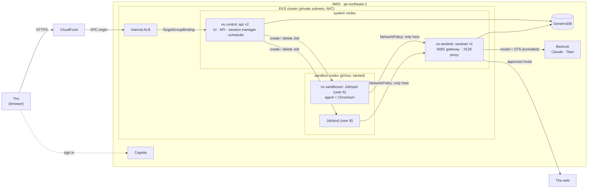

# muse-test-5 — EKS, a gVisor pod per user

> **Approach E — EKS production platform (sandboxed pods)**, per [`doc/build-your-own-muse.md`](doc/build-your-own-muse.md#approach-e--eks-production-platform-sandboxed-pods).
> Fit: 1k–100k users · gVisor pod per user · production platform.
>
> Series (simplest → production): A · [`muse-test-1`](../muse-test-1) → B · [`muse-test-2`](../muse-test-2) → C · [`muse-test-3`](../muse-test-3) → D · [`muse-test-4`](../muse-test-4) → **E · `muse-test-5` (this)** → F · Confidential compute (not built).

It's the same personal agent as [muse-test-4](../muse-test-4): chat, long-term memory, a real
browser behind approvals, background tasks and an audit trail. The app is v4's, nearly
unchanged. What changes is where it runs. Every active user gets **their own pod, under
gVisor** (a user-space kernel between the pod and the node), on nodes reserved for
sandboxes. A **NetworkPolicy** lets that pod reach the sentinel and cluster DNS, nothing
else, and the sentinel gates every connection and every stateful action for that user.

## Quick start

```bash
npm install
npx cdk deploy -c adminPrincipalArn=$(aws sts get-caller-identity --query Arn --output text)   # ~25 min

aws eks update-kubeconfig --name <ClusterName>      # the ConfigCommand output has it filled in
kubectl get pods -A                                  # api ×2, sentinel ×2, ALB controller, ...

# create yourself a user (the CreateUserCommand output has the pool ID filled in), then open the Url output
aws cognito-idp admin-create-user --user-pool-id <UserPoolId> --username you@example.com --message-action SUPPRESS
aws cognito-idp admin-set-user-password --user-pool-id <UserPoolId> --username you@example.com \
  --password '<a strong password>' --permanent

npm run test:e2e                                     # API tests as a throwaway user
npx cdk destroy MuseTest5Stack
```

Context flags for `cdk deploy`:

| Flag | Default | |
|---|---|---|
| `-c adminPrincipalArn=arn:...` | none | Makes that IAM principal cluster admin, for `kubectl` |
| `-c allowedDomains=wikipedia.org,example.com` | none | Pre-approves domains for everyone |
| `-c bedrockModelId=...` | `global.anthropic.claude-sonnet-5-5` | |
| `-c idleMinutes=5` | 10 | How long an idle sandbox lives |
| `-c sandboxNodes=3` | 1 | Sandbox nodes (m7g.large, about 3 concurrent sandboxes each). A fixed size: nothing autoscales them |

### Run it on your laptop

This is v4's Docker Compose setup, unchanged: one sandbox container per user, on an internal
network where the sentinel is the only peer.

```bash
cd app
export AWS_REGION=ap-northeast-1; eval "$(aws configure export-credentials --format env)"
docker compose up --build                  # http://localhost:8080; any name signs you in
```

The Python side uses **uv** (`app/pyproject.toml`, `app/uv.lock`): `uv sync`, `uv run pytest`, `uv run ruff check`.

## What changed from v4

| | v4 (ECS Fargate) | v5 (this) |
|---|---|---|
| Sandbox | Fargate task (Firecracker microVM), `RunTask` | **Kubernetes Job** → one pod, `runtimeClassName: gvisor` |
| Where sandboxes run | anywhere in Fargate | **their own node group** (tainted; gVisor installed by launch-template user data) |
| Sandbox network | isolated subnet with no route out + security group | **NetworkPolicy**: egress to the sentinel (3128, 8081) and kube-dns only; no ingress (VPC CNI enforces it) |
| Sandbox credentials | ECS task role | **IRSA** role, model only. Its STS call goes through the sentinel too; no Kubernetes API token |
| Session manager | api, `EcsLauncher` | api, **`KubeLauncher`**: creates or deletes Jobs from a template the stack renders |
| Cleanup | task exits | Job exits; `ttlSecondsAfterFinished: 60` deletes it |
| api / sentinel | Fargate services | Deployments ×2 on the system nodes |
| Ingress | CloudFront → internal ALB → ECS service | CloudFront → internal ALB → **TargetGroupBinding** (the ALB controller registers api pod IPs) |
| Pod hardening | — | `sandboxes` namespace enforces Pod Security **restricted**: non-root, all capabilities dropped, RuntimeDefault seccomp |
| Instance metadata | not reachable from Fargate | sandbox nodes: IMDSv2, hop limit 1, and the NetworkPolicy blocks it as well |

The app diff is small: `KubeLauncher` replaces `EcsLauncher`. The sandbox sets `HTTPS_PROXY`,
so every AWS call it makes, including STS for its IRSA credentials, goes through the
sentinel. The sentinel lets `sts.<region>.amazonaws.com` through, as it already did the
model endpoint.

**Deviations from the doc (kept simple on purpose):**

- **No operator / `AgentSession` CRD.** The session manager is still v4's `Sandboxes` class in the api: a conditional DynamoDB write picks the one live sandbox per user, and a Job is the "VM". This is enough until warm pools or hibernation need a reconcile loop.
- **No Karpenter.** There are two managed node groups, system (2× t4g.large) and sandbox (`sandboxNodes`× m7g.large, fixed). A sandbox that doesn't fit stays Pending until the 5‑minute boot timeout.
- **gVisor, not Kata.** gVisor runs on ordinary Graviton instances. Kata/Firecracker would need bare-metal nodes.
- **No Temporal, model gateway, service mesh, Argo CD, WAF or Grafana.** It's the same DynamoDB-queue design as v4, deployed by `cdk deploy`.

## System design

### Architecture



### Who can reach and do what

| | Network | IAM (IRSA) | Kubernetes RBAC |
|---|---|---|---|
| **sandbox** | out to the sentinel and DNS only; nothing in | `bedrock:InvokeModel` on its one model | none (no token mounted) |
| **sentinel** | in from sandboxes; out through NAT | the table; Titan embeddings | none |
| **api** | in from the ALB; out through NAT | the table | `create`, `delete` Jobs in `sandboxes` |

Pods on the sandbox nodes can't reach instance metadata, so they can't borrow the node role either.

The rest is v4's design: sandbox tokens, the chat-turn sequence and the sandbox lifecycle
(see [muse-test-4's README](../muse-test-4/README.md#system-design)). A sandbox is `starting`
until its first heartbeat, `running` while it heartbeats, and `lost` after 60 s without one.
An idle sandbox calls `/bye` and exits, and Kubernetes then deletes its Job.

### What CDK deploys

| Resource | Setting |
|---|---|
| VPC | 2 AZs, public and private subnets, 1 NAT; DynamoDB gateway endpoint |
| EKS | 1.35 (`aws-eks-v2`), managed `vpc-cni` with `enableNetworkPolicy`, AWS Load Balancer Controller |
| Node groups | `system`: 2–3× t4g.large · `sandbox`: `sandboxNodes`× m7g.large (default 1), taint `muse/pool=sandbox:NoSchedule`, gVisor user data |
| Kubernetes | namespaces `control`, `sentinel`, `sandboxes`; RuntimeClass `gvisor`, which adds the node selector and toleration; Deployments, Services, Role(Binding), NetworkPolicy, TargetGroupBinding |
| Image | one arm64 asset (Python 3.13 + headless Chromium), three roles |
| DynamoDB, Cognito, CloudFront | as in v4 |

### App modules (`app/muse/`)

These are the same as [v4's](../muse-test-4/README.md#app-modules-appmuse), except `sandboxes.py`, which now holds `KubeLauncher` (EKS) and `DockerLauncher` (local).

## Tests

| Command | What | Needs |
|---|---|---|
| `npm test` | 14 template tests: gVisor nodes, taint and IMDS, RuntimeClass, restricted pod security, the sandbox NetworkPolicy (exact egress), least-privilege IRSA roles and RBAC, CloudFront → ALB → TargetGroupBinding | — |
| `npm run test:app` | 85 Python unit tests (v4's suite plus `KubeLauncher`, failed launches, the address check) | — |
| `npm run test:browser`, `test:compose` | as in v4 | Chromium; Docker + AWS credentials |
| `npm run test:e2e` | the deployed stack as a throwaway Cognito user | a deployed stack |

## Operate

- **Who has a sandbox**: `kubectl -n sandboxes get pods -l muse/user=<sub>`
- **Is it really gVisor**: `kubectl -n sandboxes exec <pod> -- dmesg` prints gVisor's boot banner, not the node's kernel log.
- **Logs**: `kubectl -n control logs deploy/api`, `kubectl -n sentinel logs deploy/sentinel`, `kubectl -n sandboxes logs <pod>`
- **Release**: `npx cdk deploy`. The Deployments roll; running sandboxes finish on the old image.
- **Cost while idle**: roughly $9–10/day. That's the EKS control plane ($0.10/h), 3 nodes, the NAT gateway and the ALB.

## Known limits

- **gVisor comes from Google's release bucket at node boot.** The launch template downloads a pinned release (`GVISOR_RELEASE` in the stack), checks it against its SHA-512, and appends the `runsc` handler to containerd's config, which nodeadm has already written by then. If a node comes up without it, sandbox pods fail with `no runtime for "runsc"`; check `/var/log/cloud-init-output.log` on the node. To upgrade, change the release and redeploy, which replaces the sandbox nodes. For production, bake gVisor into a custom AMI instead.
- **DNS from the sandbox** is allowed (to kube-dns), the same narrow exfiltration channel as v4.
- **No autoscaling of sandbox nodes**, warm pool or hibernation (see Deviations).
- **Local runs hand the sandbox your AWS credentials**, and local mode trusts unsigned tokens, as in v4.

## References

- Design doc, Approach E: [`doc/build-your-own-muse.md` § Approach E](doc/build-your-own-muse.md#approach-e--eks-production-platform-sandboxed-pods)
- Sibling implementations: [`muse-test-1`](../muse-test-1) (Approach A), [`muse-test-2`](../muse-test-2) (Approach B), [`muse-test-3`](../muse-test-3) (Approach C), [`muse-test-4`](../muse-test-4) (Approach D)
- gVisor: https://gvisor.dev/docs/user_guide/containerd/quick_start/
- Kubernetes RuntimeClass: https://kubernetes.io/docs/concepts/containers/runtime-class/
- EKS network policies (VPC CNI): https://docs.aws.amazon.com/eks/latest/userguide/cni-network-policy.html
- IRSA: https://docs.aws.amazon.com/eks/latest/userguide/iam-roles-for-service-accounts.html
- TargetGroupBinding: https://kubernetes-sigs.github.io/aws-load-balancer-controller/latest/guide/targetgroupbinding/targetgroupbinding/
